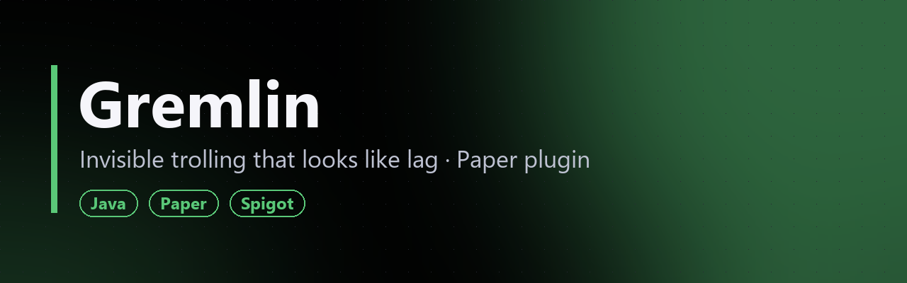

**[Русский](#русский) · [English](#english)**

> 🔒 Исходный код закрыт. В репозитории только описание плагина.
> 🔒 Source code is private. This repo contains a showcase only.

---

## Русский

**Gremlin** — плагин незаметного троллинга для Paper/Spigot (Minecraft 26.1.2). Жертва не получает ни одного сообщения: всё, что делает плагин, должно выглядеть как лаг, случайный моб или собственная невнимательность.

### Уровни
`low` → `mid` → `high` → `hard` → `evil`. Уровень задаёт и частоту пакостей, и их жёсткость.

### Пакости
- **Звуки за спиной.** Шипение крипера, шаги, выстрел из лука, скрип двери, звук копания. Все звучат направленно, из точки за игроком.
- **«Лаги».** Микротолчки, увод камеры на пару градусов, короткое замедление, откат назад, мигание экрана.
- **Мелочи.** Предметы в хотбаре меняются местами, голод идёт чуть быстрее, дёргается полоса опыта, мелькают частицы краем глаза.
- **Жёсткий эшелон.** Предмет пропадает и через 30 секунд возвращается в другой слот, выпадает из руки, сундук закрывается сам. Ещё есть фантомный удар без урона, разворот на 180° и моб-призрак за спиной.

У каждой пакости свой вес в конфиге, любую можно отключить. Жёсткие действия страхуются: предметы не теряются, урона нет.

**Команды:** `/gremlin <ник> [уровень]`, `/gremlin list`, `/gremlin now <ник> [пакость]`, `/gremlin clear`, `/gremlin reload`.

---

## English

**Gremlin** is a stealth-trolling plugin for Paper/Spigot (Minecraft 26.1.2). The victim never gets a single message: everything it does should look like lag, a random mob, or their own carelessness.

### Levels
`low` → `mid` → `high` → `hard` → `evil`. The level sets both how often pranks happen and how harsh they are.

### Pranks
- **Sounds behind you.** A creeper hiss, footsteps, a bow shot, a creaking door, mining noises. All of them are directional, played from a point behind the player.
- **"Lag".** Micro-nudges, a camera drift of a couple of degrees, a short slowdown, rubber-banding, a screen blink.
- **Small stuff.** Swapped hotbar items, slightly faster hunger, a twitching XP bar, particles at the edge of vision.
- **The hard tier.** An item vanishes and comes back 30 s later in another slot, drops from the hand, or a chest closes by itself. There's also a phantom hit with no damage, a 180° spin and a ghost mob behind you.

Every prank has a configurable weight and can be disabled. Hard pranks are safeguarded: no items are lost and no damage is dealt.

**Commands:** `/gremlin <player> [level]`, `/gremlin list`, `/gremlin now <player> [prank]`, `/gremlin clear`, `/gremlin reload`.
